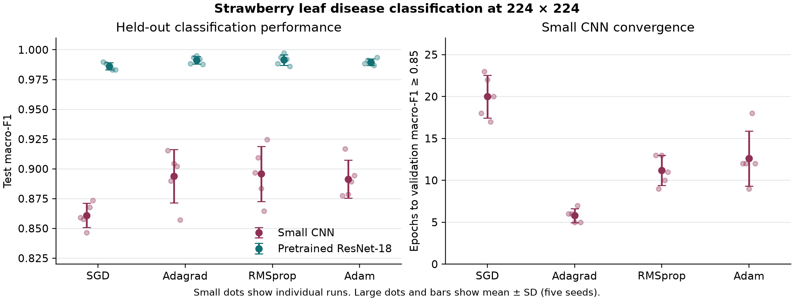
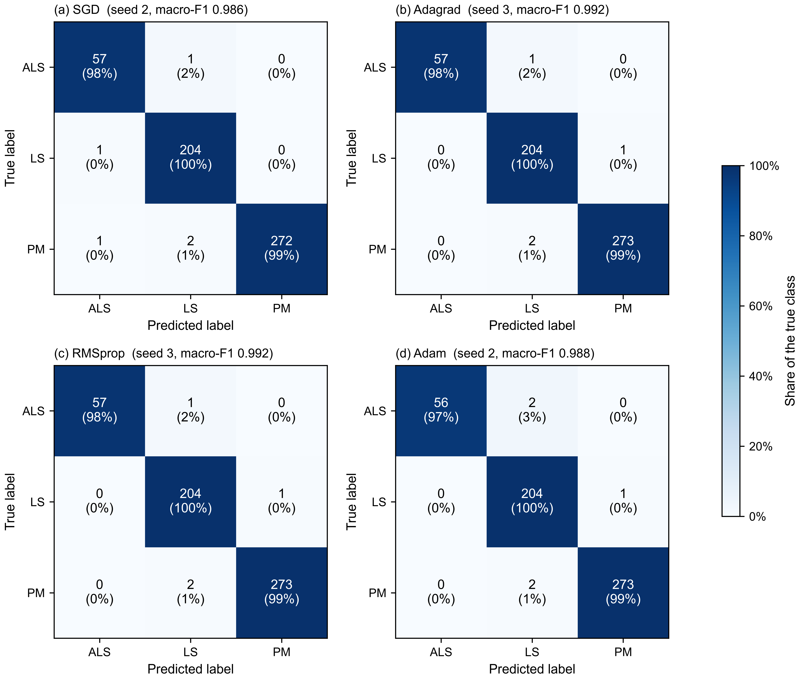

# Comparing Four Optimizers for Strawberry Leaf Disease Classification

**Isabel Aziz-Hendrick · AI Applications final project · Jeonbuk National University**

How much does the choice of optimizer affect a strawberry leaf classifier? This project compares **SGD, Adagrad, RMSprop and Adam** on a small PyTorch CNN trained on a laptop CPU. It then repeats the comparison with an ImageNet-pretrained ResNet-18.

The inputs are cropped RGB images of individual strawberry leaves from three classes: angular leaf spot, leaf spot and powdery mildew. The primary experiment uses 224 × 224 inputs for both models.

## Results

| Optimizer | Small CNN learning rate | Small CNN test macro-F1 | Epochs to validation F1 ≥ 0.85 | ResNet-18 learning rate | ResNet-18 test macro-F1 |
| --- | ---: | ---: | ---: | ---: | ---: |
| SGD | 0.1 | 0.861 ± 0.010 | 20.0 ± 2.5 | 0.01 | 0.986 ± 0.003 |
| Adagrad | 0.01 | 0.894 ± 0.022 | **5.8 ± 0.8** | 0.001 | 0.991 ± 0.003 |
| RMSprop | 0.003 | **0.896 ± 0.023** | 11.2 ± 1.8 | 0.0001 | 0.991 ± 0.004 |
| Adam | 0.0003 | 0.891 ± 0.016 | 12.6 ± 3.3 | 0.0003 | 0.990 ± 0.003 |

Values are means ± sample standard deviation over five seeds. The small-CNN test macro-F1 differences did not reach significance after Holm correction. Adagrad reached the validation target in significantly fewer epochs than the other optimizers (Holm-adjusted paired-test p ≤ 0.008), so it was selected by the study's decision rule. Angular leaf spot was the hardest class and accounted for much of SGD's lower mean score.

The report gives mean wall-clock times to the small-CNN target of **362 s for Adagrad, 670 s for RMSprop, 673 s for Adam and 1,162 s for SGD**. The recorded SGD seed-0 time includes a laptop sleep interruption. The report replaces the affected epoch with that run's median epoch time for its timing summary. [The run CSV](docs/results/smallcnn-224/results.csv) preserves the recorded values. A separate training-step benchmark estimated about **830 CPU-seconds** for Adagrad to reach the target.

ResNet-18 reached test macro-F1 of **0.986–0.991** across the four optimizers. All 20 ResNet-18 runs reached the validation target of 0.80 after one epoch. The model comparison combines a change in architecture and ImageNet pretraining. ResNet-18 used a GPU and a different convergence target, so the timing measurements apply to each experiment separately.



## Dataset and experiment design

The [Strawberry Disease Detection Dataset on Roboflow Universe](https://universe.roboflow.com/strawberry-disease/strawberry-disease-detection-dataset) supplied the source images and YOLO annotations. The study used version 4, reported as CC BY 4.0. Preprocessing kept three leaf classes from the seven exported classes, grouped and deduplicated source photos, and cropped annotated leaves. Splitting by source photo kept crops from each photo together. See the [preprocessing counts](docs/data/preprocessing_summary.txt).

| Split | Source photos | Angular leaf spot | Leaf spot | Powdery mildew | Total crops |
| --- | ---: | ---: | ---: | ---: | ---: |
| Train | 872 | 269 | 968 | 1,131 | 2,368 |
| Validation | 187 | 49 | 210 | 264 | 523 |
| Test | 188 | 58 | 205 | 275 | 538 |
| **Total** | **1,247** | **376** | **1,383** | **1,670** | **3,429** |

- **Small CNN:** four convolution blocks with 16, 32, 64 and 128 filters, global average pooling, a 64-unit dense layer and three output logits. It has 105,891 trainable parameters and uses training-set channel statistics for normalisation.
- **ResNet-18:** ImageNet-pretrained weights and ImageNet normalisation. Only the last residual stage and the new three-class head are trained.
- **Training:** batch size 32, cross-entropy loss, up to 40 epochs and early stopping with patience 10. SGD uses no momentum. Learning rates are selected by validation macro-F1 from a six-value grid for each model using seed 100. Final runs use paired seeds 0–4 and test the best validation checkpoint.
- **Evaluation:** macro-F1 weights each disease class equally. The selection rule evaluates test macro-F1 first, epochs to target second and wall-clock time to target third. Pairwise comparisons use Holm-adjusted paired t-tests.

## Figures and files

| Contents | Where to look |
| --- | --- |
| Primary 224 × 224 small CNN | [Recorded run metrics](docs/results/smallcnn-224/results.csv) · [Learning-rate sweep table](docs/results/smallcnn-224/sweep_validation_f1.csv) · [Summary figure](docs/figures/optimizer_results_224.png) |
| Pretrained ResNet-18 | [Final runs](docs/results/resnet18/final/) · [Learning-rate sweep](docs/results/resnet18/sweep/) · [Original figures PDF](docs/figures/resnet18/All_figures.pdf) |
| Earlier 128 × 128 small CNN | [Archived results and methodology](docs/results/smallcnn-128/README.md) · [Original small-CNN figures](docs/figures/smallcnn/) · [Earlier cross-model figures](docs/figures/comparison/) |
| Preprocessing and experiments | [Python scripts](scripts/) · [Preprocessing counts](docs/data/preprocessing_summary.txt) · [Provenance and limitations](docs/PROVENANCE.md) |

### Original ResNet-18 figures



[Training curves](docs/figures/resnet18/Figure_1_training_curves.png) · [Test performance](docs/figures/resnet18/Figure_2_test_performance.png) · [Convergence and timing](docs/figures/resnet18/Figure_3_convergence_and_time.png) · [Generalisation](docs/figures/resnet18/Figure_S1_generalisation.png)

## Reproduce the experiments

Run the commands from the repository root in a Python environment. Use Python 3.10 or newer. Use a CUDA-compatible PyTorch and torchvision build to reproduce the GPU setup. The pretrained ResNet-18 requires access to the ImageNet weights distributed by torchvision on first use.

```sh
git clone https://github.com/isabelhendrick-sudo/StrawberryDisease_Optimizer_Comparison.git
cd StrawberryDisease_Optimizer_Comparison
python -m pip install -r requirements.txt
```

Download the Roboflow v4 YOLOv8 export to `data/` and pass its ZIP path or extracted folder containing `data.yaml` to the preprocessing script. It writes an image-folder dataset in `strawberry_cls/`. Check the resulting counts against [the archived split summary](docs/data/preprocessing_summary.txt).

```sh
python scripts/clean_datasets.py "data/Strawberry Disease Detection Dataset.v4.zip" --out strawberry_cls
python scripts/train_optimizers.py smoke --data strawberry_cls --out runs/smallcnn-224 --model smallcnn --img 224 --device cpu
python scripts/train_optimizers.py sweep --data strawberry_cls --out runs/smallcnn-224 --model smallcnn --img 224 --device cpu --target-f1 0.85
python scripts/train_optimizers.py final --data strawberry_cls --out runs/smallcnn-224 --model smallcnn --img 224 --device cpu --target-f1 0.85
python scripts/analyze_optimizers.py runs/smallcnn-224/final
```

```sh
python scripts/train_optimizers.py sweep --data strawberry_cls --out runs/resnet18 --model resnet18 --img 224 --device cuda --target-f1 0.85 --lr-grid 0.01 0.003 0.001 0.0003 0.0001 0.00003
python scripts/train_optimizers.py final --data strawberry_cls --out runs/resnet18 --model resnet18 --img 224 --device cuda --target-f1 0.80
python scripts/analyze_optimizers.py runs/resnet18/final
python scripts/make_figures.py --runs runs/resnet18/final --out runs/resnet18/figures
```

The scripts write aggregate run results, epoch histories and predictions. Use a fresh output directory when changing settings or data. The trainer resumes completed runs by optimizer, learning rate and seed. Add `--save-weights` to a final command to retain checkpoints. The supplied trainer logs test metrics during sweeps, while choosing rates exclusively from validation macro-F1.

Regenerate the README's summary plot from the included CSVs without retraining:

```sh
python scripts/plot_primary_results.py
```

## Scope

The held-out scores describe three classes of annotated leaf crops from this dataset. Generalisation to full greenhouse images, unseen farms or cultivars, healthy leaves, and nutrient stress remains unmeasured. The study uses five paired seeds, one photo-group split and a single learning-rate sweep seed per model.
