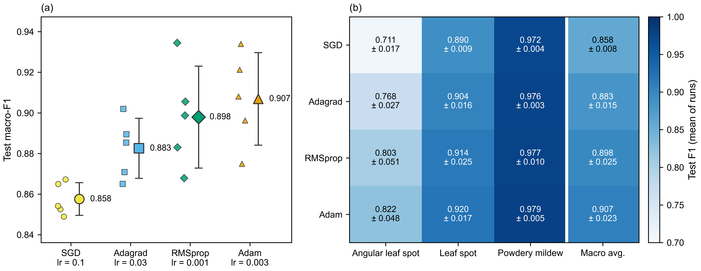

# Archived 128 × 128 small-CNN experiment

This earlier comparison used 128 × 128 crops. The [main README](../../../README.md) covers the November 224 × 224 experiment.

| Optimizer | Learning rate | Test macro-F1 | Epochs to validation macro-F1 ≥ 0.85 |
| --- | ---: | ---: | ---: |
| SGD | 0.1 | 0.858 ± 0.008 | 17.4 ± 2.1 |
| Adagrad | 0.03 | 0.883 ± 0.015 | 10.4 ± 2.6 |
| RMSprop | 0.001 | 0.898 ± 0.025 | 6.2 ± 2.2 |
| Adam | 0.003 | 0.907 ± 0.023 | 6.0 ± 1.9 |

Values are means ± sample standard deviation over five paired seeds. Adam had the highest mean test macro-F1. The decision rule left Adam, RMSprop and Adagrad unresolved.

[Original 20-run CSV](../../../results.csv) · [Summary](summary.csv) · [Paired tests](significance.csv) · [Per-class metrics](per_class_metrics.csv) · [Decision](decision.txt)

## Original figures

[Training curves](../../figures/smallcnn/Figure_1_training_curves.png) · [Convergence](../../figures/smallcnn/Figure_3_convergence_and_time.png) · [Confusion matrices](../../figures/smallcnn/Figure_4_confusion_matrices.png) · [Generalisation](../../figures/smallcnn/Figure_S1_generalisation.png)
